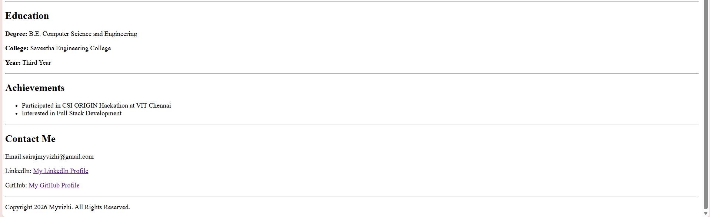

# portfolioexp1
# Ex01 Portfolio
# Date:02.11.2026
# AIM
To create a Portfolio using HTML and CSS.

# ALGORITHM
STEP 1
Create an HTML file (index.html)

STEP 2
Create a CSS file (style.css)

STEP 3
Include a navigation bar with links to different sections.

STEP 4
Add structured sections for introduction, about, projects, and contact details.

STEP 5
Define global styles for fonts, colors, and layout.

STEP 6
Style the header, navigation bar, and sections.

STEP 7
Use Flexbox or CSS Grid for layout design.

STEP 8
Add hover effects and transitions for interactivity.

STEP 9
Add Images and Media.

STEP 10
Use optimized images for a professional look.

STEP 11
Open the HTML file in a browser to check layout and functionality.

STEP 12
Fix styling issues and refine content placement.

STEP 13
Deploy the Portfolio.

STEP 14
Upload to GitHub Pages for free hosting.

# PROGRAM
```

<!DOCTYPE html>
<html>
<head>
    <title>My Portfolio</title>
</head>
<body>

    <h1>My Portfolio</h1>
    <p>Welcome to my personal portfolio!</p>

    <hr>

    <h2>Home</h2>
    <p>Hello! I am Myvizhi.</p>
    <p>I am a Computer Science Engineering student.</p>
    <p>My goal is to become a Full Stack Developer.</p>

    <hr>

    <h2>About Me</h2>
    <p>
        I am currently pursuing my third year of
        B.E. Computer Science and Engineering at
        Saveetha Engineering College.
    </p>
    <p>I love coding and learning new technologies.</p>

    <hr>

    <h2>My Skills</h2>
    <ul>
        <li>HTML</li>
        <li>Java</li>
        <li>Python</li>
        <li>C Programming</li>
        <li>Spring Boot</li>
    </ul>

    <hr>

    <h2>My Projects</h2>

    <h3>1. Personal Portfolio</h3>
    <p>A website to showcase my skills and achievements.</p>

    <h3>2. AI-Based Project</h3>
    <p>A project that uses Artificial Intelligence.</p>

    <h3>3. Full Stack Web Application</h3>
    <p>A web application with frontend and backend features.</p>

    <hr>

    <h2>Education</h2>
    <p><b>Degree:</b> B.E. Computer Science and Engineering</p>
    <p><b>College:</b> Saveetha Engineering College</p>
    <p><b>Year:</b> Third Year</p>

    <hr>

    <h2>Achievements</h2>
    <ul>
        <li>Participated in CSI ORIGIN Hackathon at VIT Chennai</li>
        <li>Interested in Full Stack Development</li>
    </ul>

    <hr>

    <h2>Contact Me</h2>
    <p>Email:sairajmyvizhi@gmail.com</p>
    <p>
        LinkedIn:
        <a href="https://www.linkedin.com/in/myvizhi-sairaj-69b80a327">My LinkedIn Profile</a>
    </p>
    <p>
        GitHub:
        <a href="https://github.com/Myvizhi5">My GitHub Profile</a>
    </p>

    <hr>

    <footer>
        <p>Copyright 2026 Myvizhi. All Rights Reserved.</p>
    </footer>

</body>
</html>
```
# OUTPUT


# RESULT
The program for creating Portfolio using HTML and CSS is executed successfully.